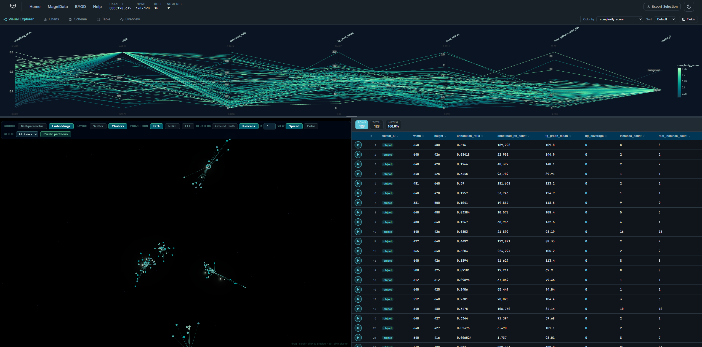

# MagniData: Closing the Loop Between Dataset Features and Model Failures in Computer Vision

*Official release notes and technical report · Precision AI · October 2026*

MagniData started as a way to see what is inside a large image dataset. It is now also a way to
find out **why a model fails on it**, and to act on the answer. A model's per-image behaviour
during training (loss, rank, trend, hardness, prediction) joins the same linked views as the
photometric, geometric and embedding features of the data. Failures can then be explained by
the images themselves, checked against the annotations, compared across models, and fixed by
building a better dataset with its lineage recorded.

<p align="center">
  
</p>

A four-page technical report with figures accompanies this release:
[`docs/paper/magnidata-technical-report.pdf`](docs/paper/magnidata-technical-report.pdf).

## The problem

Training a segmentation or detection model gives you a number, such as mIoU, and a curve. When
the number is disappointing, the usual next steps are a bigger model, more epochs, more labels,
or a new architecture. Each is expensive, and each is a guess made without answering the
questions that decide which one is right:

- **Is the annotation wrong?** Is this "failure" a model error or a label error?
- **Is the model actually struggling with these instances or classes?** Or is the aggregate metric hiding a handful of bad images?
- **Is the failure a capacity problem?** Does a larger model fail on the *same* images as the small one?
- **Is it the architecture or the dataset?** If every model fails on the same samples, no architecture change will help.
- **What do we add?** Which unlabeled images look like the hard ones, so labeling effort goes where it matters?
- **Where did this dataset come from?** Which dataset and which run produced which result?

Existing tools answer parts of this. Experiment trackers show aggregate curves. Sample browsers
show images and labels. Label-noise tools rank suspicious labels. None of them puts the
training dynamics of every image in the same space as the dataset's own structure, so the
questions above are answered by inspection, intuition and spreadsheets.

## What is new in this release

### 1. Every image gets a training history, and it is a dataset axis

Train from the portal (the reference U-Net and LRASPP presets, or the optional AgriTune
frozen-feature presets) or log a run from your own trainer. After each scored epoch the model
re-scores every image in eval mode, without augmentation, and the loss of each term is stored
per image. MagniData turns these files into regular columns:

| Column | What it tells you |
|---|---|
| `loss_<term>` | how wrong the model is on this image at the selected epoch, per loss term |
| `loss_<term>_mean` | how hard the image is across the whole run |
| `loss_<term>_delta` / `_slope` | whether the model is still learning it, or has stopped improving |
| `loss_<term>_rank` | percentile within the image's own split, so train and val are never mixed |
| `hardness` | the share of scored epochs in which the image was in the worst fifth of its split |
| `split`, `iou`, `confidence` | which side of the partition the image is on, how good the mask is, how sure the model was |

These columns are parallel-coordinates axes, 3D colour-by fields, histograms, table columns and
filters, **next to** the colour, exposure, sharpness, noise, geometry and embedding features.
A scrubber moves the whole dashboard through the scored epochs. The image preview shows the
ground truth, the mask, the overlay and the **model's prediction** with the image's per-term
loss curves, so you can compare label and prediction at a glance.

### 2. Diagnosis: reading the failure instead of guessing it

Because loss is decomposed per term and sits beside the data features, the common failure
modes have a recognisable signature:

| You see | It usually means | What to do |
|---|---|---|
| High `hardness`, high `loss_total_mean`, flat slope, ground truth disagrees with the prediction when you open it | **Annotation problem** (wrong, missing or shifted label) | Select, **Export relabel queue**, fix, retrain |
| High `loss_dice_rank`, low `loss_cce_rank` | Pixels are mostly right but the region's **shape** is off: a coarse or shifted mask | Check mask quality, not the class list |
| High `loss_cce_rank` and low `confidence` | The model does not know **what** it is looking at: ambiguous classes or too few examples | Add examples of that kind, or merge classes |
| Hard samples cluster on a feature axis (low sharpness, small `annotation_ratio`, a restricted hue band) | A **coverage or quality gap** in the data | Add images from that region of feature space |
| Hard on `val`, easy on `train` | Overfitting, or a split that differs from training | Regularise, or re-split |
| Large positive `delta`, negative `slope` | Still learning | Train longer before judging |

### 2b. From one hard sample to a population: brush by similarity

Open a hard sample and read its feature values in the preview. Then brush a narrow band around
them on a few parallel-coordinates axes (sharpness, noise, object area, hue). The surviving
polylines are its look-alikes, and the 3D view, histograms, table and counts update with them.
If the look-alikes are also hard, you have found a **tendency** (a region of feature space where
the model fails as a group), which points to coverage or quality. If they are easy, the sample
is an outlier of its own neighbourhood and its label is the first suspect. Widening the band
until neighbour hardness returns to the dataset base rate gives a rough extent of the failure
region. The band is drawn by hand today; a one-click "brush around this sample" is planned.

### 3. Is it the model or the data? Compare two runs image by image

**Compare on dataset** takes any two runs on the same images and gives every image
`cmp_hardness_change` and `cmp_loss_total_change` (positive means it got harder), drawn on a
diverging scale centred on zero. This turns "do we need a bigger model?" into something you can look at:

- The larger model's hard set is **a subset of the small model's** and the rest improved: capacity was the limit.
- The **same images stay hard** in both, and they are the ones with flagged labels or a shared feature signature: the limit is **the dataset**, and a bigger model will not fix it.
- Different images are hard in different models: an **architecture-specific** weakness. Ensembling or changing the decoder may help.
- Runs from different engines are directly comparable, because every engine writes the same per-sample contract. That includes the reference trainer, the AgriTune presets and trainers you log yourself.

**With AgriTune the "why" gets sharper.** AgriTune calls a hosted embedding API once per original
image, caches the patch-level features of a general-purpose agricultural encoder, and trains a
lightweight decoder (MLP Probe, TokenFPN) on them, distilling the encoder's broad knowledge into a
task decoder. The encoder is never fine-tuned. Image-space augmentation would cost one API call per
augmented view, so the cached recipe leaves it out (the Train dialog defaults to *Image augmentation:
None*). Reading the same hard set across engines separates four causes an aggregate metric merges:
**capacity** (a larger decoder fixes it), **representation** (only the end-to-end model fixes it),
**missing invariance** (survivors share a photometric signature that augmentation would cover) and
**labels or coverage** (the same images stay hard everywhere). This procedure is supported by the
tool; we have not yet run the full study.

The comparison needs no new training harness. It is a per-image join of two sets of MLflow artifacts.

### 4. Improve the dataset from the hard samples, in the same screen

1. Brush `hardness` (or press **High-loss samples**) and look at what the survivors have in common on the photometric, geometry and embedding axes.
2. **Save as dataset** to keep the selection as a new dataset, or **Export relabel queue** to give the annotators the selected images with losses, hardness and your notes, hardest first.
3. **Complement**: expand the selection with the *unseen* images from the combined Cloud pool that are nearest to its standardized feature centroid, so new labeling effort goes to images that resemble the failures. Removals staged in the preview are applied in the same step.
4. **Train on it** reopens the Train dialog with the overlaid run's settings, and the new run records the old one as its parent.
5. **Compare on dataset** shows whether those images actually stopped being hard.

The original dataset is never modified. Every step produces a new, named dataset.

### 5. Lineage you can see and query

The Workspace is now a lineage graph: every derived dataset (selection, merge, complement, tile partition) keeps its parents; every run keeps its dataset and parent run.

- Cards show an experiment badge (yellow and pulsing while a run is queued or training), with run counts per dataset.
- A selected dataset highlights its ancestors and descendants, and the side panel shows its statistics, sample images, annotation coverage, runs and lineage.
- Shift-click several cards to **merge** them into a de-duplicated union with all sources as parents; `POST /api/datasets/<id>/parents` edits the parents with cycle checks.
- `partition_dataset` tiles a large dataset into fixed-size crops and registers balanced sub-datasets under the source.

The result is a traceable answer to "which data and which run produced this model?", with no
spreadsheet and no naming convention to remember.

### 6. An open training contract and two engines

MLflow is the system of record. The training contract defines the tags, metric keys, artifact
layout and per-sample loss CSV that the API reads. That is why the reference trainer, the optional
AgriTune engine and external trainers (including pai-seed runs) all appear in the same
Experiments view, with the same overlays and comparisons.

- **Add a model or a metric** is documented in the User Guide: a preset becomes a Train dialog option, a per-image loss term becomes an Explorer axis, and an epoch metric becomes a chart.
- The API rejects settings the chosen engine cannot honour instead of silently ignoring them.
- GPU training is a Compose override. On AgriStress-500 at 256 px on an RTX 5070 an epoch drops from about 31 min on CPU to about 2 s once the resized-image cache is warm.
- Cancelling an AgriTune run now stops it within seconds, and AgriTune metrics are logged once per epoch to keep MLflow small.

### 7. Documentation

The in-portal **User Guide** takes a new user from `docker compose up` to a curated, retrained
dataset on AgriStress-500, with 19+ screenshots generated from the real UI. New chapters cover
bringing your own data, adding embeddings, training with AgriTune, and adding a model or a metric.

## Why the combination matters

Each ingredient has a precedent: training-dynamics maps, forgetting events, confident learning,
embedding browsers, experiment trackers. The advantage of MagniData is that they are **joined on
the image**, in one interactive surface, with provenance:

| Question | Without MagniData | With MagniData |
|---|---|---|
| Which images does the model fail on? | Aggregate mIoU; ad-hoc scripts over logged losses | `hardness` and per-term ranks as brushable axes |
| Model error or label error? | Open files one by one | Ground truth vs prediction vs per-term loss in one preview; relabel queue export |
| Do we need a bigger model? | Train it and compare scalars | Per-image hardness change between two runs |
| Architecture or dataset limit? | Intuition | Same images hard across engines means data; different images means architecture |
| What data to add? | More of everything | Feature-nearest unseen images to the hard set |
| Did the fix work? | Compare final metrics | Per-image change on the curated set, parent run linked |
| Where did this come from? | Folder names | Dataset and run lineage graph |

## Positioning

MagniData does not replace annotation tools, experiment trackers or training frameworks. It
reads from MLflow, writes new dataset CSVs, and leaves labeling to your annotation tool. It
complements instance-centric viewers by adding a dataset-wide, multivariate and
model-aware view. The training-dynamics signals here are heuristics for prioritising
inspection, not proofs of label error or of sufficient capacity. The report states what has and
has not been evaluated.

## Coming next

A contrastive-learning edition is planned. It targets the main limit of the cached AgriTune recipe: invariances that augmentation normally teaches, which today cost one API call per view.

## Limitations and what we are measuring next

- The complement uses distance to the selection's standardized feature centroid within a shared-column Cloud pool. It is a fast, explainable heuristic, not a per-image nearest-neighbour search or a learned retrieval model.
- Per-sample scoring costs one extra evaluation pass per scored epoch; `score_every` trades resolution for time.
- Only the hardest samples of each epoch have a saved prediction mask. Other images fall back to the nearest earlier epoch, and say so.
- The training workflows are verified end to end on AgriStress-500 and a small demo run. We have not yet published quantitative results on label-noise detection or on dataset-quality gains across benchmarks; those are the next evaluation.
- Parallel coordinates need axis grouping and ranking as column counts grow, and large plots render a deterministic 3,000-line representation while all counts, tables and selections use every row.

## Upgrade notes

- Training is opt-in per run. The default build is unchanged; add `docker-compose.gpu.yml` for CUDA and `docker-compose.agritune.yml` for AgriTune (clone AgriTune beside this repository).
- No change to existing dataset CSVs or embeddings files.
- See `CHANGELOG.md` for the full list of additions and fixes.

## Benchmark

The current reference environment is a WSL2 Linux instance on an AMD Ryzen AI 9 365
(10 cores / 20 threads), with 15 GiB of system memory and an NVIDIA GeForce RTX 5070
Laptop GPU with 8 GiB of VRAM. The API and web containers share the host's 15 GiB
container memory limit. These results were collected on 17 September 2026 using the
47,281-row `Stress-47k` dataset, with a 19.0 MB feature CSV and a 1.1 GB, 1024-dimensional
embedding sidecar.

### Rendering architecture

Graph3D uses Three.js `WebGLRenderer` with custom shader materials, `Float32Array`
buffers, and an `EffectComposer` bloom pass. The 47k points are therefore submitted to
the browser's WebGL implementation and can be rendered by the GPU when the browser has
hardware-accelerated WebGL enabled. The Docker web container does not render the scene
and does not use CUDA. CSV parsing, JavaScript object creation, client-side
multiparametric PCA, and interaction bookkeeping run on the CPU. Embedding projection
and embedding-space clustering run in the API's Python process on the CPU; changing
those algorithms to GPU implementations would require a separate CUDA-compatible
backend and would not accelerate the browser's WebGL drawing itself.

### Measured timings and memory

| Stage | Measured result |
|---|---:|
| CSV download from the API | 0.042 s, 19.9 MB |
| Browser-equivalent CSV parse (Node/Papa Parse, 42 columns) | 0.618 s; approximately 157 MB additional heap |
| Cold embedding-matrix load after API restart | approximately 15 s; streams and parses the 1.1 GB JSON sidecar |
| Precomputed PCA response | 0.073 s, 2.95 MB |
| Precomputed t-SNE response | 0.066 s, 2.79 MB |
| Precomputed LLE response | 0.082 s, 3.30 MB |
| Uncached LLE computation | 13.27 s |
| Uncached spherical K-means, `k=21` | 13.40 s |
| API container after embedding work | approximately 630 MiB resident |

The projection timings include the API request and response but not browser parsing,
GPU buffer upload, animation, or the first painted frame. An end-to-end browser paint
time and FPS measurement was not collected in this WSL session because no browser
automation or WebGL profiler is installed; those should be measured separately with the
target browser and hardware. The timings nevertheless identify the present bottlenecks:
the initial CSV parse and JavaScript row representation consume substantially more
memory than the point buffers, while the first embedding-matrix load and uncached LLE
or K-means dominate compute latency. The 1.1 GB embedding JSON is parsed by the API,
not downloaded by the browser, and the current streaming parser reports no intermediate
progress during that phase. Once the matrix and result are cached, the API response is
effectively sub-second; repeated K changes are primarily limited by whether a new
clustering result must be computed.

## Usage

```bash
git clone git@github.com:Precision-AI-Inc/magnidata.git
cd magnidata
docker compose up --build
```

Open the dashboard at `http://localhost:5175`.

From the landing screen, open MagniData and choose a prepared demo, build from a local
folder under `image_sets/`, upload your own images, or load a CSV that follows the
MagniData data contract.


### Feature Extraction

```bash
python -m precisionai.magnidata.tools.features --input images.csv --output features.csv
```


### Feature Format

```csv
image_path,annotation_ratio,blur_laplacian,noise_sigma,colorfulness,complexity_score,camera_angle
image_sets/field/images/img_001.jpg,0.421,318.7,4.8,27.1,0.63,oriented
```

Minimal requirements are Docker for the full application or Python for the feature
extractor. Embeddings are optional; when present, they unlock the embedding-space 3D
view.

## Contact and collaboration

For bug reports, feature requests, and collaboration on MagniData, contact the main
project collaborator, Reinier, at [reinier@precision.ai](mailto:reinier@precision.ai).
