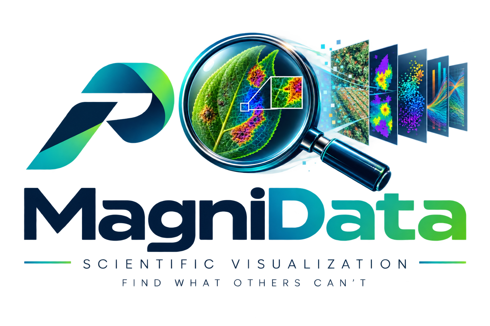

  

# Precision AI MagniData

This Space shows two image datasets in MagniData: you can browse the images and their segmentation masks, filter
them by per-image quality and complexity metrics, and see their embeddings in 3D.

MagniData is Precision AI's open-source explorer for image datasets: a deterministic feature-extraction pipeline, a
Flask API, and a React/Three.js dashboard for browsing images, segmentation masks and embeddings, including a live 3D
PCA / t-SNE / cluster view over a dataset's embedding space.

This Space runs the dashboard with two datasets already loaded, so you can open it and explore:

- **COCO128**: 128 everyday scenes with real instance segmentation polygons.
- **AgriStress-500**: 451 field images of crops and weeds with segmentation masks, from
  [Precision AI's dataset](https://huggingface.co/datasets/precisionaiinc/AgriStress-500) (CC-BY-NC-4.0). Images here
  are downsized for this demo ([AgriStress-500-Downsized](https://huggingface.co/datasets/precisionaiinc/AgriStress-500-Downsized));
  the feature table and embeddings come from the full-resolution originals.

For each dataset you get parallel coordinates, histograms and a table over per-image complexity, quality and
coverage metrics, image, mask and overlay previews, and the 3D embeddings view.

This is a demo on small CPU hardware, so it is read-only. Anything that adds, changes or deletes data (uploading a CSV,
adding, merging, saving or deleting datasets, creating partitions), and training and the Experiments tab, is disabled
here: those controls show "Disabled for the Demo". To use them, run the full stack with `docker compose up` from the
[GitHub repository](https://github.com/Precision-AI-Inc/magnidata), where nothing is turned off.

Scripts and agents can query the same data without a browser: the API at
`https://precisionaiinc-magnidata.hf.space/api` answers read-only requests without authentication (start with
`/api/datasets`). See [Use it from a script or an agent](https://github.com/Precision-AI-Inc/magnidata#use-it-from-a-script-or-an-agent)
for the endpoints and examples.

The Space repository holds only this card and a `Dockerfile` that builds MagniData from GitHub.
